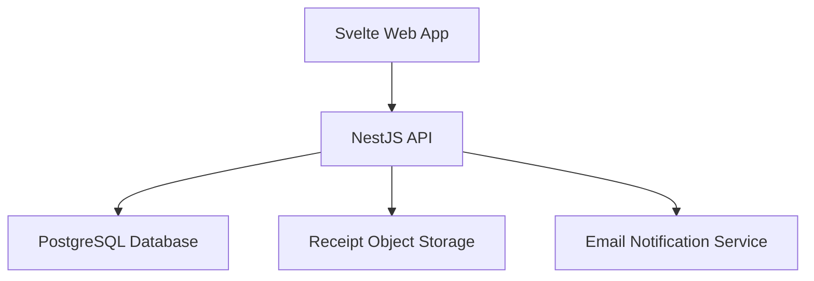
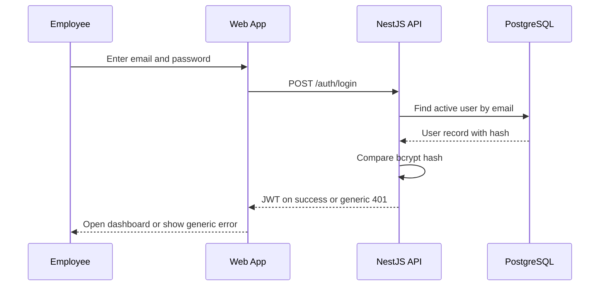
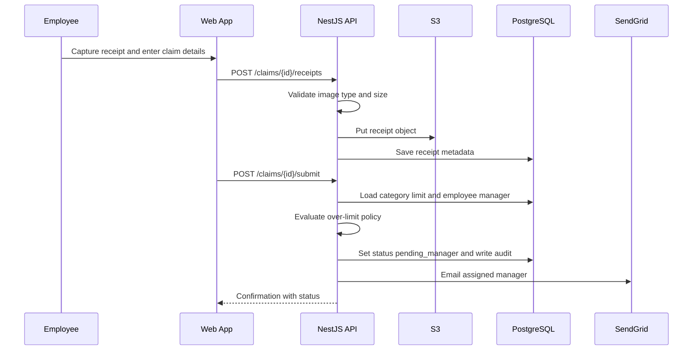
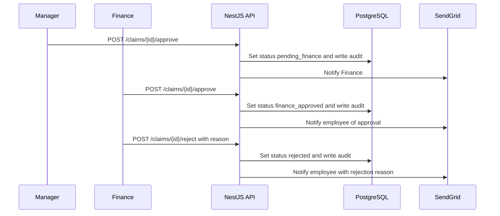
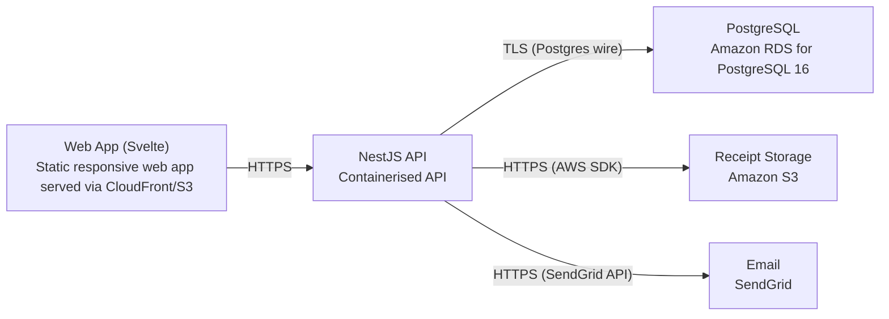

# Architecture

> Maintained by QuorQ AI SDLC. Text between `sdlc:auto` markers is regenerated; anything outside them is yours and is kept.

<!-- sdlc:auto:start narrative -->
## Overview

### ARCH-001 · approved · source: architecture:summary

Approved v1 architecture: Svelte 5 frontend, NestJS 11 API, PostgreSQL 16, AWS ap-south-1 (Mumbai) with S3 receipt storage and SendGrid email, satisfying DPDP residency and the approved stack.

Lightweight expense claim web app for <100 employees in India. Employees sign in (email/password), create INR claims (amount, date, category, description), and upload receipt images including phone-browser camera capture, stored in S3 Mumbai. Claims flow sequentially Employee -> Manager -> Finance, with rejection reasons returned to the employee and resubmission support. Admin/Finance manage users, roles, manager assignments and categories with optional INR limits enforced at submission. Finance marks claims reimbursed (recording only), filters/exports to CSV, and every claim keeps a chronological audit trail. Status-change emails via SendGrid; DPDP privacy notice at onboarding. All personal data and receipts are kept inside India (ap-south-1) for DPDP residency.

**Related:** REQ-SCOPE, EPIC-001, EPIC-002, EPIC-003, EPIC-004, EPIC-005, EPIC-006, EPIC-007, EPIC-008, EPIC-009

### ARCH-002 · approved · source: architecture:component:web_app

Svelte Web App -- the responsive UI for every user-facing function.

Svelte 5 responsive web UI for sign-in, claim creation and receipt capture (phone-browser camera via standard file-input capture attribute), employee/manager/finance dashboards and queues, admin configuration, claims export trigger, and the DPDP privacy notice. Enforces role-appropriate (RBAC-aware) client-side navigation and is designed to work on phone browsers.

**Related:** US-001, US-007, US-008, US-010, US-011, US-012, US-013, US-015, US-018

### ARCH-003 · approved · source: architecture:component:api_backend

NestJS API -- REST backend for auth, RBAC, claim lifecycle, approvals, admin, audit trail, export, receipt upload orchestration and notification dispatch.

NestJS 11 modules (auth, claims, approvals, categories, users, notifications) with guards enforcing JWT and role-based access on every route. Endpoints: POST /auth/login (generic failure error), POST /auth/logout, GET /me, POST /me/privacy-notice/ack, GET /privacy-notice; GET/POST /users, PATCH /users/{id} (Admin only); GET/POST /categories, PATCH /categories/{id} (Admin only); POST /claims (draft), PATCH /claims/{id}, POST /claims/{id}/receipts, GET /claims/{id}/receipts/{receiptId}/url (signed, time-limited), POST /claims/{id}/submit (limit check, blocks if no manager), GET /claims/mine, GET /claims/{id} (owner or authorised approver/finance); GET /approvals/manager-queue, GET /approvals/finance-queue, POST /claims/{id}/approve, POST /claims/{id}/reject (required reason), POST /claims/{id}/reimburse (recording only); GET /claims (Finance, filterable), GET /claims/export (CSV).

**Related:** US-001, US-002, US-003, US-004, US-005, US-006, US-007, US-008, US-009, US-010, US-011, US-012, US-013, US-014, US-015, US-016, US-017, US-018

### ARCH-004 · approved · source: architecture:component:database

PostgreSQL Database -- India-hosted relational store enforcing consistent claim status transitions.

Entities: users (id, email, password_hash, full_name, role, manager_id, is_active, privacy_notice_ack_at, created_at); categories (id, name, limit_amount, is_active, created_at); claims (id, employee_id, category_id, amount, currency, expense_date, description, status, over_limit_flag, last_rejection_reason, created_at, updated_at); receipts (id, claim_id, s3_key, file_name, content_type, size_bytes, uploaded_at); claim_audit (id, claim_id, actor_user_id, action, from_status, to_status, comment, created_at). Hosted on RDS PostgreSQL 16 in Mumbai for residency and transactional consistency (a claim cannot be both reimbursed and rejected).

**Related:** US-003, US-004, US-005, US-006, US-007, US-016, US-019

### ARCH-005 · approved · source: architecture:component:object_store

Receipt Object Storage -- durable, in-India S3 storage for receipt images, served via signed URLs.

Amazon S3 (ap-south-1 Mumbai) stores receipt image files durably, kept out of the database, and served to authorised roles only via time-limited signed URLs -- satisfying NFR-005 (authorised-role-only access) and NFR-007 (India residency).

**Related:** US-008, US-019, NFR-005, NFR-007

### ARCH-006 · approved · source: architecture:component:email_service

Email Notification Service -- SendGrid delivery of claim status-change emails.

SendGrid delivers emails for claim submitted, advanced to finance, approved, rejected (with reason), and reimbursed, to the relevant manager, Finance or employee recipients.

**Related:** US-017

### ARCH-007 · approved · source: architecture:critical_path:sign_in

Critical path: sign-in and session handling.

Employee signs in with email/password; backend verifies a bcrypt hash and issues a JWT. Failed attempts return a generic error that does not reveal which field was wrong; sign-out discards the token; deactivated users cannot sign in.

**Related:** US-001, US-002

### ARCH-008 · approved · source: architecture:critical_path:create_submit_claim

Critical path: create and submit a claim with receipts and limit check.

Employee enters amount (INR), date, category, description and uploads receipt images; uploads are validated for type/size, stored in S3, with metadata saved. On submit, the category limit is checked (over-limit claims flagged or blocked per policy); otherwise the claim becomes pending manager approval, an audit entry is written, and the manager is emailed. Submission is blocked if the employee has no assigned manager.

**Related:** US-004, US-007, US-008, US-009

### ARCH-009 · approved · source: architecture:critical_path:approval_workflow

Critical path: sequential Manager -> Finance approval workflow.

Manager sees only their team's pending claims; approves (advances to Finance) or rejects with a required reason (returns to employee). Finance sees only manager-approved claims; approves (finance-approved, reimbursement-eligible) or rejects with a reason. Every transition writes an audit entry and sends the relevant email.

**Related:** US-012, US-013, US-016, US-017

### ARCH-010 · approved · source: architecture:deployment_nodes

Deployment topology: all components hosted in AWS ap-south-1 (Mumbai) for DPDP residency.

Web App: static responsive Svelte 5 build served via CloudFront/S3. NestJS API: containerised Node.js (NestJS 11) service. PostgreSQL: Amazon RDS for PostgreSQL 16. Receipt Storage: Amazon S3 bucket (ap-south-1 Mumbai). Email: SendGrid SaaS API (external, not India-hosted -- email content is notification metadata, not the personal-data store itself).

**Related:** US-019, NFR-007

### ARCH-011 · approved · source: architecture:technology_decisions

Technology decisions and rationale for frontend, backend, database and cloud, as approved by the product owner.

Frontend: Svelte 5 (alternatives considered: React, Vue) -- responsive UI, phone camera capture via file input, client-side RBAC-aware navigation. Backend: NestJS 11 (alternatives: Express, Fastify) -- modular structure (auth, claims, approvals, categories, users, notifications) with guards enforcing JWT/role access on every route. Database: PostgreSQL 16 (alternatives: MySQL, SQLite) -- transactional consistency for claim status, hosted on RDS Mumbai. Cloud: AWS (alternatives: Azure, GCP) -- ap-south-1 Mumbai hosts API, RDS and S3 in one in-country region for DPDP residency and native S3 pairing.

**Related:** REQ-SCOPE
<!-- sdlc:auto:end narrative -->

<!-- sdlc:auto:start building-blocks -->
## Building Block View

| ID | Name | Technology | Responsibility | Depends on |
|---|---|---|---|---|
| web_app | Svelte Web App | Svelte 5 | Responsive web UI for sign-in, claim creation and receipt capture, dashboards, approval queues, admin config, claims export trigger and privacy notice; enforces role-appropriate navigation and works on phone browsers including camera capture. | api_backend |
| api_backend | NestJS API | NestJS 11 | REST API for authentication, RBAC enforcement, claim lifecycle, approval workflow, category/limit and user administration, audit trail, CSV export, receipt upload orchestration and notification dispatch. | database, object_store, email_service |
| database | PostgreSQL Database | PostgreSQL 16 | India-hosted relational store for users, roles, manager assignments, categories, limits, claims, receipt metadata and the per-claim audit trail, enforcing consistent claim status transitions. | — |
| object_store | Receipt Object Storage | Amazon S3 (ap-south-1 Mumbai) | Durable in-India storage of receipt image files, kept out of the database and served to authorised roles via time-limited signed URLs. | — |
| email_service | Email Notification Service | SendGrid | Delivers claim status-change emails (submitted, advanced to finance, approved, rejected with reason, reimbursed) to the relevant users. | — |

<!-- sdlc:auto:end building-blocks -->

<!-- sdlc:auto:start runtime -->
## Runtime View

### Sign-in and session

Employee signs in with email/password; backend verifies the bcrypt hash and issues a JWT. Failed attempts return a generic error not revealing which field was wrong; sign-out discards the token. Deactivated users cannot sign in.

- **Components:** web_app, api_backend, database
- **Modules:** AuthModule, UsersModule
- **Key functions:** signIn(email, password), validateUser(email, password), issueJwt(user), signOut()

### Create and submit claim with receipts and limit check

Employee enters amount (INR), date, category, description and uploads receipt images. Uploads are validated for type and size, stored in S3, and metadata saved. On submit the category limit is checked; over-limit claims are flagged or blocked, otherwise the claim becomes pending manager approval, an audit entry is written and the manager is emailed. Submission is blocked if the employee has no assigned manager.

- **Components:** web_app, api_backend, object_store, database, email_service
- **Modules:** ClaimsModule, ReceiptsModule, CategoriesModule, AuditModule, NotificationsModule
- **Key functions:** uploadReceipt(claimId, file), validateFile(file), createClaim(dto), checkCategoryLimit(categoryId, amount), submitClaim(claimId), recordAudit(claimId, action, actor, comment), notify(event, claim)

### Sequential approval workflow

Manager sees only their team's pending claims, approves (advances to finance) or rejects with a required reason (returns to employee). Finance sees only manager-approved claims, approves (finance-approved, eligible for reimbursement) or rejects with reason. Every transition writes an audit entry and sends the relevant email.

- **Components:** web_app, api_backend, database, email_service
- **Modules:** ApprovalsModule, ClaimsModule, AuditModule, NotificationsModule
- **Key functions:** getManagerQueue(managerId), getFinanceQueue(), approveClaim(claimId, actor), rejectClaim(claimId, actor, reason), advanceStatus(claim), recordAudit(...), notify(...)

<!-- sdlc:auto:end runtime -->

<!-- sdlc:auto:start deployment-view -->
## Deployment View

| Name | Service | Runtime | Scaling | Environment |
|---|---|---|---|---|
| Web App (Svelte) | Static responsive web app served via CloudFront/S3 | Svelte 5 build | CDN edge, single company load | dev |
| NestJS API | Containerised API | Node.js (NestJS 11) | Single small instance, vertical if needed (<100 users) | dev |
| PostgreSQL | Amazon RDS for PostgreSQL 16 | PostgreSQL 16 | Single instance in ap-south-1, encrypted at rest | dev |
| Receipt Storage | Amazon S3 | S3 bucket (ap-south-1 Mumbai) | Elastic object storage, private bucket | dev |
| Email | SendGrid | SaaS API | Managed | dev |

| Source | Target | Protocol |
|---|---|---|
| Web App (Svelte) | NestJS API | HTTPS |
| NestJS API | PostgreSQL | TLS (Postgres wire) |
| NestJS API | Receipt Storage | HTTPS (AWS SDK) |
| NestJS API | Email | HTTPS (SendGrid API) |

<!-- sdlc:auto:end deployment-view -->

<!-- sdlc:auto:start decisions -->
## Architecture Decisions

| Layer | Choice | ADR |
|---|---|---|
| Frontend | Svelte | [ADR-0001](adr/frontend.md) |
| Backend | NestJS | [ADR-0002](adr/backend.md) |
| Database | PostgreSQL | [ADR-0003](adr/database.md) |
| Cloud | AWS | [ADR-0004](adr/cloud.md) |
<!-- sdlc:auto:end decisions -->

<!-- sdlc:auto:start links -->
## Related Documents

- [Data Model](data-model.md)
- [API Specification](api/openapi.yaml)
- [Architecture Decision Records](adr/README.md)
<!-- sdlc:auto:end links -->
