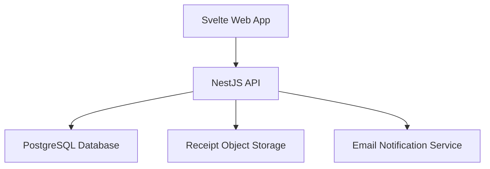
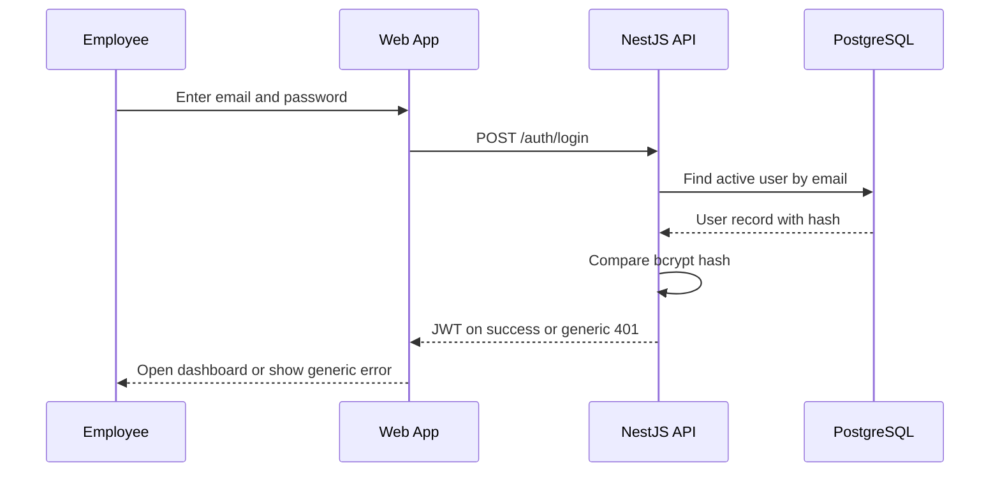
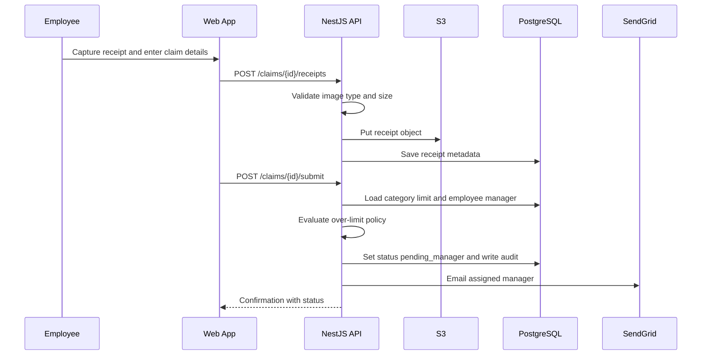
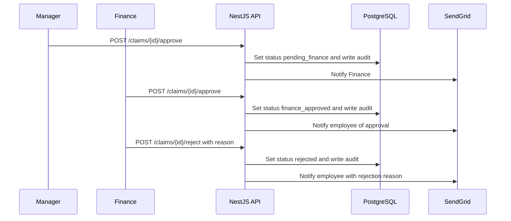
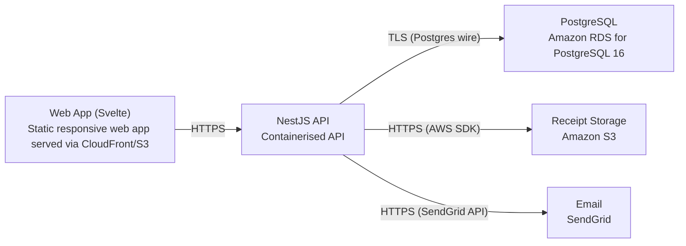

# Architecture

> Maintained by QuorQ AI SDLC. Text between `sdlc:auto` markers is regenerated; anything outside them is yours and is kept.

<!-- sdlc:auto:start narrative -->
## Overview

### ARCH-001 · approved · source: architecture:summary

Lightweight web app for a single Indian company (<100 employees) to submit, approve and reimburse INR expense claims with receipt images, built on Svelte 5, NestJS 11, PostgreSQL 16 and AWS (ap-south-1 Mumbai).

Approved v1 architecture. Employees sign in with email/password, create INR claims (amount, date, category, description) and upload one or more receipt images (including phone-browser camera capture) stored in S3. Claims flow sequentially Employee -> Manager -> Finance; rejections return to the employee with a reason for resubmission. Admin/Finance manage users, roles, manager assignments and categories with optional per-category INR limits enforced at submission. Finance records reimbursement (no payment processing), filters/exports claims to CSV, and every claim keeps a chronological audit trail. Status-change emails go via SendGrid; a DPDP privacy notice is shown at onboarding. All compute, database and object storage are kept in AWS Mumbai for DPDP data residency.

**Related:** ARCH-COMP-WEB, ARCH-COMP-API, ARCH-COMP-DB, ARCH-COMP-S3, ARCH-COMP-EMAIL

- ⚠ No explicit mapping provided between this architecture and requirement IDs US-001..019; traceability to specific user stories cannot be confirmed from this input alone.
- ⚠ No date or author/approver name given for the v1 approval.
- ⚠ SendGrid is a non-Indian SaaS notification provider; architecture claims personal data and receipts are kept inside India for DPDP residency, but email notifications (containing employee names/emails and claim status) are routed through SendGrid, which is not stated to have in-India data processing -- potential residency conflict to confirm.

### ARCH-COMP-WEB · approved · source: architecture:components.web_app

Svelte 5 responsive web UI covering sign-in, claim creation/receipt capture, dashboards, approval queues, admin config, CSV export trigger and the privacy notice.

Component: Svelte Web App (Svelte 5). Responsibilities: sign-in; claim creation and receipt capture (including phone-browser camera via file input capture attribute); employee dashboard; manager/finance approval queues; admin configuration screens; triggering claims CSV export; displaying the DPDP privacy notice. Enforces role-appropriate navigation client-side and works on phone browsers.

**Related:** ARCH-COMP-API

### ARCH-COMP-API · approved · source: architecture:components.api_backend

NestJS 11 REST API handling authentication, RBAC, claim lifecycle, approvals, admin, audit trail, CSV export and notification dispatch.

Component: NestJS API (NestJS 11). Structured into modules: auth, claims, approvals, categories, users, notifications, each guarded by JWT and role-based access checks on every route. Orchestrates receipt upload to S3, enforces category limit checks, writes audit entries on every status transition, and dispatches emails via SendGrid.

**Related:** ARCH-COMP-WEB, ARCH-COMP-DB, ARCH-COMP-S3, ARCH-COMP-EMAIL

### ARCH-COMP-DB · approved · source: architecture:components.database

India-hosted PostgreSQL 16 store for users, roles, manager assignments, categories, limits, claims, receipt metadata and the audit trail.

Component: PostgreSQL Database (PostgreSQL 16), hosted on RDS in ap-south-1 (Mumbai). Enforces consistent claim status transitions transactionally (e.g. a claim cannot be both reimbursed and rejected). Holds all relational entities; receipt files themselves are kept out of the database in S3.

**Related:** ARCH-COMP-API, ARCH-DATA-001

### ARCH-COMP-S3 · approved · source: architecture:components.object_store

Amazon S3 (ap-south-1 Mumbai) durable storage for receipt image files, served to authorised roles via time-limited signed URLs.

Component: Receipt Object Storage, Amazon S3 in Mumbai. Keeps receipt binaries out of the database; access is mediated by the API, which issues time-limited signed URLs only to authorised roles (owner or authorised approver/finance).

**Related:** ARCH-COMP-API

### ARCH-COMP-EMAIL · approved · source: architecture:components.email_service

SendGrid delivers claim status-change emails (submitted, advanced to finance, approved, rejected with reason, reimbursed) to relevant users.

Component: Email Notification Service, SendGrid. Triggered by the API on every claim status transition to notify the relevant employee, manager or finance user.

**Related:** ARCH-COMP-API

- ⚠ SendGrid is a third-party SaaS outside the stated AWS-Mumbai boundary; whether it offers in-India data processing/residency guarantees for the personal data in these emails (names, emails, claim amounts/status) is not addressed in the input and should be confirmed against the DPDP residency goal stated in the overall architecture summary.

### ARCH-CP-SIGNIN · approved · source: architecture:critical_paths.Sign-in and session

Email/password sign-in flow with bcrypt verification, JWT issuance, generic failure messaging, and deactivation/sign-out handling.

Employee signs in with email/password; backend verifies the bcrypt password hash and issues a JWT. Failed attempts return a generic error that does not reveal which field (email or password) was wrong. Sign-out discards the token. Users marked deactivated cannot sign in.

**Related:** ARCH-COMP-WEB, ARCH-COMP-API, ARCH-COMP-DB

### ARCH-CP-SUBMIT · approved · source: architecture:critical_paths.Create and submit claim with receipts and limit check

Employee creates an INR claim, uploads validated receipt images to S3, and submits it subject to a category limit check and manager assignment check.

Employee enters amount (INR), date, category and description, and uploads receipt images; uploads are validated for type and size, stored in S3, and metadata saved to the database. On submit, the category limit is checked: over-limit claims are flagged or blocked (architecture does not specify which behaviour applies in which case); otherwise the claim becomes pending manager approval, an audit entry is written, and the manager is emailed. Submission is blocked entirely if the employee has no assigned manager.

**Related:** ARCH-COMP-WEB, ARCH-COMP-API, ARCH-COMP-S3, ARCH-COMP-DB, ARCH-CP-APPROVAL

- ⚠ The input states over-limit claims are 'flagged or blocked' without specifying the rule that decides which outcome applies -- needs clarification.

### ARCH-CP-APPROVAL · approved · source: architecture:critical_paths.Sequential approval workflow

Sequential Manager-then-Finance approval workflow with required rejection reasons, per-transition audit entries and email notifications.

Manager sees only their own team's pending claims; can approve (advances claim to finance) or reject with a required reason (returns claim to employee for resubmission). Finance sees only manager-approved claims; can approve (finance-approved, eligible for reimbursement) or reject with a required reason. Every transition writes a claim_audit entry and sends the relevant status-change email.

**Related:** ARCH-COMP-API, ARCH-COMP-DB, ARCH-COMP-EMAIL, ARCH-CP-SUBMIT

### ARCH-DATA-001 · approved · source: architecture:entities

Five-table relational data model: users, categories, claims, receipts and claim_audit, covering identity, configuration, claim lifecycle, receipt metadata and audit history.

users(id, email, password_hash, full_name, role, manager_id, is_active, privacy_notice_ack_at, created_at). categories(id, name, limit_amount, is_active, created_at). claims(id, employee_id, category_id, amount, currency, expense_date, description, status, over_limit_flag, last_rejection_reason, created_at, updated_at). receipts(id, claim_id, s3_key, file_name, content_type, size_bytes, uploaded_at). claim_audit(id, claim_id, actor_user_id, action, from_status, to_status, comment, created_at).

**Related:** ARCH-COMP-DB

### ARCH-API-001 · approved · source: architecture:endpoints

Full REST surface: auth/session, privacy notice, user and category admin, claim CRUD and receipts, submission, approvals/rejections/reimbursement, and finance listing/export.

Auth/session: POST /auth/login (generic error on failure), POST /auth/logout, GET /me (incl. privacy-notice ack state). Privacy notice: POST /me/privacy-notice/ack, GET /privacy-notice (viewable anytime). Admin: GET/POST /users, PATCH /users/{id} (role, manager, deactivate) -- Admin only. Categories: GET /categories (active ones selectable), POST /categories, PATCH /categories/{id} (edit/deactivate without affecting existing claims) -- Admin only. Claims: POST /claims (draft), PATCH /claims/{id} (draft/returned only), POST /claims/{id}/receipts (type/size validated, stored in S3), GET /claims/{id}/receipts/{receiptId}/url (signed, time-limited, authorised roles only), POST /claims/{id}/submit (limit check, blocked without manager), GET /claims/mine, GET /claims/{id} (full detail incl. receipts and audit history, owner or authorised approver/finance only). Approvals: GET /approvals/manager-queue, GET /approvals/finance-queue, POST /claims/{id}/approve, POST /claims/{id}/reject (reason required), POST /claims/{id}/reimburse (recording only, no payment). Finance: GET /claims (filterable by status/employee/category/date), GET /claims/export (CSV).

**Related:** ARCH-COMP-API, ARCH-CP-SIGNIN, ARCH-CP-SUBMIT, ARCH-CP-APPROVAL, ARCH-DATA-001

### ARCH-DEPLOY-001 · approved · source: architecture:deployment_nodes

All infrastructure except email runs in AWS ap-south-1 (Mumbai): static CloudFront/S3 web app, containerised NestJS API, RDS PostgreSQL, S3 receipt bucket; SendGrid is the one external SaaS dependency.

Web App: static responsive Svelte 5 build served via CloudFront/S3. NestJS API: containerised Node.js (NestJS 11) service. PostgreSQL: Amazon RDS for PostgreSQL 16. Receipt Storage: Amazon S3 bucket in ap-south-1 (Mumbai). Email: SendGrid, external SaaS API (not an AWS-Mumbai node).

**Related:** ARCH-COMP-WEB, ARCH-COMP-API, ARCH-COMP-DB, ARCH-COMP-S3, ARCH-COMP-EMAIL

- ⚠ SendGrid is the only deployment node outside the AWS Mumbai boundary -- see residency flag on ARCH-COMP-EMAIL.

### ARCH-TECH-001 · approved · source: architecture:technology_decisions

Four stack decisions, each with alternatives considered: Svelte over React/Vue, NestJS over Express/Fastify, PostgreSQL over MySQL/SQLite, and AWS over Azure/GCP.

Frontend: Svelte 5 chosen (alternatives: React, Vue) for the responsive UI, phone-browser camera capture via file input capture attribute, and client-side RBAC-aware navigation. Backend: NestJS 11 chosen (alternatives: Express, Fastify) to structure the API into auth/claims/approvals/categories/users/notifications modules with JWT and role guards on every route. Database: PostgreSQL 16 chosen (alternatives: MySQL, SQLite) for transactional consistency (e.g. preventing a claim being both reimbursed and rejected) and RDS hosting in Mumbai for residency. Cloud: AWS chosen (alternatives: Azure, GCP), using Mumbai (ap-south-1) to host API, RDS and S3 together in one in-country region for DPDP data residency, pairing natively with S3.

**Related:** ARCH-COMP-WEB, ARCH-COMP-API, ARCH-COMP-DB, ARCH-DEPLOY-001
<!-- sdlc:auto:end narrative -->

<!-- sdlc:auto:start building-blocks -->
## Building Block View

| ID | Name | Technology | Responsibility | Depends on |
|---|---|---|---|---|
| web_app | Svelte Web App | Svelte 5 | Responsive web UI for sign-in, claim creation and receipt capture, dashboards, approval queues, admin config, claims export trigger and privacy notice; enforces role-appropriate navigation and works on phone browsers including camera capture. | api_backend |
| api_backend | NestJS API | NestJS 11 | REST API for authentication, RBAC enforcement, claim lifecycle, approval workflow, category/limit and user administration, audit trail, CSV export, receipt upload orchestration and notification dispatch. | database, object_store, email_service |
| database | PostgreSQL Database | PostgreSQL 16 | India-hosted relational store for users, roles, manager assignments, categories, limits, claims, receipt metadata and the per-claim audit trail, enforcing consistent claim status transitions. | — |
| object_store | Receipt Object Storage | Amazon S3 (ap-south-1 Mumbai) | Durable in-India storage of receipt image files, kept out of the database and served to authorised roles via time-limited signed URLs. | — |
| email_service | Email Notification Service | SendGrid | Delivers claim status-change emails (submitted, advanced to finance, approved, rejected with reason, reimbursed) to the relevant users. | — |

<!-- sdlc:auto:end building-blocks -->

<!-- sdlc:auto:start runtime -->
## Runtime View

### Sign-in and session

Employee signs in with email/password; backend verifies the bcrypt hash and issues a JWT. Failed attempts return a generic error not revealing which field was wrong; sign-out discards the token. Deactivated users cannot sign in.

- **Components:** web_app, api_backend, database
- **Modules:** AuthModule, UsersModule
- **Key functions:** signIn(email, password), validateUser(email, password), issueJwt(user), signOut()

### Create and submit claim with receipts and limit check

Employee enters amount (INR), date, category, description and uploads receipt images. Uploads are validated for type and size, stored in S3, and metadata saved. On submit the category limit is checked; over-limit claims are flagged or blocked, otherwise the claim becomes pending manager approval, an audit entry is written and the manager is emailed. Submission is blocked if the employee has no assigned manager.

- **Components:** web_app, api_backend, object_store, database, email_service
- **Modules:** ClaimsModule, ReceiptsModule, CategoriesModule, AuditModule, NotificationsModule
- **Key functions:** uploadReceipt(claimId, file), validateFile(file), createClaim(dto), checkCategoryLimit(categoryId, amount), submitClaim(claimId), recordAudit(claimId, action, actor, comment), notify(event, claim)

### Sequential approval workflow

Manager sees only their team's pending claims, approves (advances to finance) or rejects with a required reason (returns to employee). Finance sees only manager-approved claims, approves (finance-approved, eligible for reimbursement) or rejects with reason. Every transition writes an audit entry and sends the relevant email.

- **Components:** web_app, api_backend, database, email_service
- **Modules:** ApprovalsModule, ClaimsModule, AuditModule, NotificationsModule
- **Key functions:** getManagerQueue(managerId), getFinanceQueue(), approveClaim(claimId, actor), rejectClaim(claimId, actor, reason), advanceStatus(claim), recordAudit(...), notify(...)

<!-- sdlc:auto:end runtime -->

<!-- sdlc:auto:start deployment-view -->
## Deployment View

| Name | Service | Runtime | Scaling | Environment |
|---|---|---|---|---|
| Web App (Svelte) | Static responsive web app served via CloudFront/S3 | Svelte 5 build | CDN edge, single company load | dev |
| NestJS API | Containerised API | Node.js (NestJS 11) | Single small instance, vertical if needed (<100 users) | dev |
| PostgreSQL | Amazon RDS for PostgreSQL 16 | PostgreSQL 16 | Single instance in ap-south-1, encrypted at rest | dev |
| Receipt Storage | Amazon S3 | S3 bucket (ap-south-1 Mumbai) | Elastic object storage, private bucket | dev |
| Email | SendGrid | SaaS API | Managed | dev |

| Source | Target | Protocol |
|---|---|---|
| Web App (Svelte) | NestJS API | HTTPS |
| NestJS API | PostgreSQL | TLS (Postgres wire) |
| NestJS API | Receipt Storage | HTTPS (AWS SDK) |
| NestJS API | Email | HTTPS (SendGrid API) |

<!-- sdlc:auto:end deployment-view -->

<!-- sdlc:auto:start decisions -->
## Architecture Decisions

| Layer | Choice | ADR |
|---|---|---|
| Frontend | Svelte | [ADR-0001](adr/frontend.md) |
| Backend | NestJS | [ADR-0002](adr/backend.md) |
| Database | PostgreSQL | [ADR-0003](adr/database.md) |
| Cloud | AWS | [ADR-0004](adr/cloud.md) |
<!-- sdlc:auto:end decisions -->

<!-- sdlc:auto:start links -->
## Related Documents

- [Data Model](data-model.md)
- [API Specification](api/openapi.yaml)
- [Architecture Decision Records](adr/README.md)
<!-- sdlc:auto:end links -->
