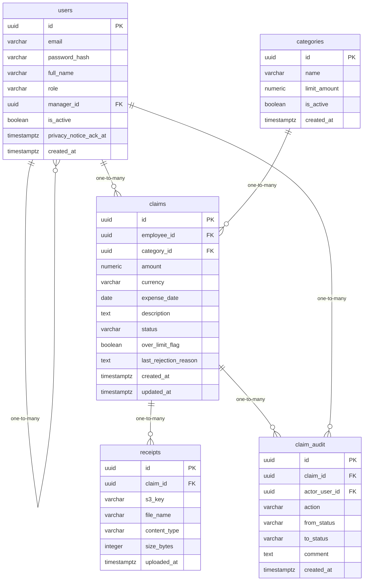

# Data Model

<!-- sdlc:auto:start entities -->
### users

| Field | Type | PK | FK | Nullable |
|---|---|---|---|---|
| id | uuid | True | — | False |
| email | varchar | False | — | False |
| password_hash | varchar | False | — | False |
| full_name | varchar | False | — | False |
| role | varchar | False | — | False |
| manager_id | uuid | False | users.id | True |
| is_active | boolean | False | — | False |
| privacy_notice_ack_at | timestamptz | False | — | True |
| created_at | timestamptz | False | — | False |

### categories

| Field | Type | PK | FK | Nullable |
|---|---|---|---|---|
| id | uuid | True | — | False |
| name | varchar | False | — | False |
| limit_amount | numeric | False | — | True |
| is_active | boolean | False | — | False |
| created_at | timestamptz | False | — | False |

### claims

| Field | Type | PK | FK | Nullable |
|---|---|---|---|---|
| id | uuid | True | — | False |
| employee_id | uuid | False | users.id | False |
| category_id | uuid | False | categories.id | False |
| amount | numeric | False | — | False |
| currency | varchar | False | — | False |
| expense_date | date | False | — | False |
| description | text | False | — | True |
| status | varchar | False | — | False |
| over_limit_flag | boolean | False | — | False |
| last_rejection_reason | text | False | — | True |
| created_at | timestamptz | False | — | False |
| updated_at | timestamptz | False | — | False |

### receipts

| Field | Type | PK | FK | Nullable |
|---|---|---|---|---|
| id | uuid | True | — | False |
| claim_id | uuid | False | claims.id | False |
| s3_key | varchar | False | — | False |
| file_name | varchar | False | — | False |
| content_type | varchar | False | — | False |
| size_bytes | integer | False | — | False |
| uploaded_at | timestamptz | False | — | False |

### claim_audit

| Field | Type | PK | FK | Nullable |
|---|---|---|---|---|
| id | uuid | True | — | False |
| claim_id | uuid | False | claims.id | False |
| actor_user_id | uuid | False | users.id | False |
| action | varchar | False | — | False |
| from_status | varchar | False | — | True |
| to_status | varchar | False | — | True |
| comment | text | False | — | True |
| created_at | timestamptz | False | — | False |
<!-- sdlc:auto:end entities -->

<!-- sdlc:auto:start relationships -->
| Source | Target | Type |
|---|---|---|
| users | users | one-to-many |
| users | claims | one-to-many |
| categories | claims | one-to-many |
| claims | receipts | one-to-many |
| claims | claim_audit | one-to-many |
| users | claim_audit | one-to-many |
<!-- sdlc:auto:end relationships -->

<!-- sdlc:auto:start er-diagram -->

<!-- sdlc:auto:end er-diagram -->
