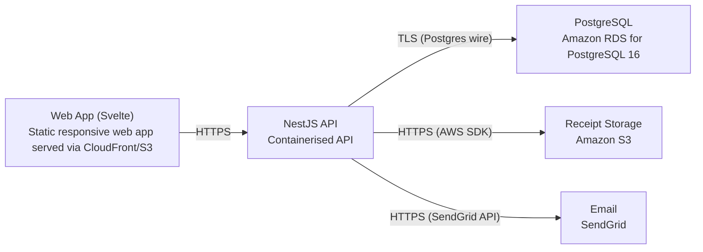

# Deployment Guide

> Maintained by QuorQ AI SDLC. Text between `sdlc:auto` markers is regenerated; anything outside them is yours and is kept.

<!-- sdlc:auto:start how-it-deploys -->
Pushes to `main` run `.github/workflows/deploy.yml`, which builds the API image (if there is a backend) and deploys the SPA to AWS Amplify. Commits touching only `docs/sdlc/**` don't deploy. Deployments can also be started from the platform's Deployment tab.
<!-- sdlc:auto:end how-it-deploys -->

<!-- sdlc:auto:start environments -->
| Name | Service | Runtime | Scaling | Environment |
|---|---|---|---|---|
| Web App (Svelte) | Static responsive web app served via CloudFront/S3 | Svelte 5 build | CDN edge, single company load | dev |
| NestJS API | Containerised API | Node.js (NestJS 11) | Single small instance, vertical if needed (<100 users) | dev |
| PostgreSQL | Amazon RDS for PostgreSQL 16 | PostgreSQL 16 | Single instance in ap-south-1, encrypted at rest | dev |
| Receipt Storage | Amazon S3 | S3 bucket (ap-south-1 Mumbai) | Elastic object storage, private bucket | dev |
| Email | SendGrid | SaaS API | Managed | dev |
<!-- sdlc:auto:end environments -->

<!-- sdlc:auto:start live -->
_Not deployed yet._
<!-- sdlc:auto:end live -->

<!-- sdlc:auto:start topology -->

<!-- sdlc:auto:end topology -->
